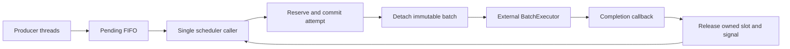
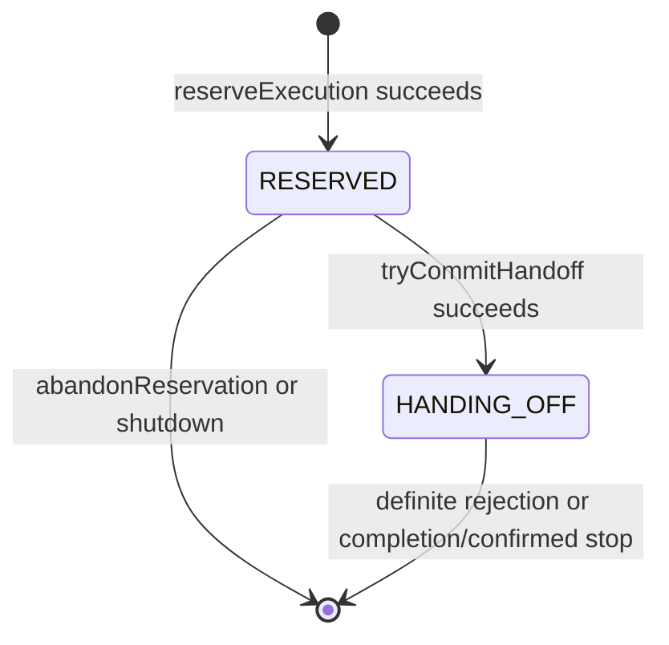

# LLM Inference Request Scheduler

*Java 21 design for FIFO batching, bounded execution, cancellation, and lifecycle coordination*

Status: learning implementation; lifecycle incomplete; integrated verification pending  
Updated: November 23, 2026  
Language: Java 21  
Implementation: [BatchScheduler.java](src/main/java/dev/concurrencylab/batching/BatchScheduler.java)

## 1. Problem and context

Coordinate concurrent request submission and cancellation with a single scheduler that forms FIFO batches and limits outstanding backend execution attempts. Prevent excessive concurrent submissions, stale queue decisions, double release, and shutdown/handoff races.

The intended Java serving layer sits between a chat/agent orchestrator and an inference backend. A customer turn can generate several model calls, possibly separated by tool execution. Each model call is independently scheduled. Customer sessions, Java threads, execution attempts, and execution slots are different identities.

For a future real-backend integration, the backend may own tokenization, model execution, KV-cache management, continuous batching, and streaming. Java tokenUnits are currently caller-supplied estimates. One Java batch is not necessarily one GPU batch. The BatchExecutor contract is an educational boundary that must be adapted to a real backend.

## 2. Goals and non-goals

### Goals

- Form a nonempty FIFO batch with at most eight requests and 4,096 estimated token units.
- Use a fixed five-millisecond forming window, subject to earlier limit-based dispatch.
- Allow cancellation while requests are pending.
- Bound owned execution reservations to two, including reservations not yet executing.
- Register ownership before external submission can trigger completion.
- Return each owned slot at most once.
- Coordinate shutdown with reservation and handoff commitment.
- Keep external executor calls outside the shared lock.
- Make state transitions understandable, testable, and diagnosable in Java.

### Non-goals for this implementation

Actual inference, GPU kernels, distributed coordination, durable execution, automatic retries, KV tensors, post-dispatch execution cancellation, streaming results, hard real-time latency guarantees, admission capacity, tenant fairness, and an internally managed scheduler thread. This module does not inherit the bounded admission guarantees of Problem 001 automatically.

Queued-request shutdown policy and full termination are unresolved, not implemented guarantees.

## 3. Architecture and responsibilities



- Producers submit Request objects and receive per-submission cancellation handles.
- The queue owns pending requests. A Candidate is only an inspection result, not ownership transfer.
- The scheduler caller drives dispatchNextBatch, at most one batch per invocation. An external long-lived loop may call it repeatedly; condition waits avoid polling.
- The dispatch operation owns a detached batch until the submission outcome establishes responsibility.
- An accepting executor owns execution and must report completion or confirmed stopping.
- A rejecting executor guarantees the batch will never run. The caller receives the detached batch through DispatchResult.Rejected.
- Completion can execute inline on the scheduler caller or on another thread. The scheduler component owns accounting regardless of the invoking thread.

## 4. Data model

| Representation | Meaning | Protection |
| --- | --- | --- |
| Request(id, tokenUnits, payload) | Input; ID is a descriptive label, not duplicate suppression | Immutable record; caller must not mutate payload while pending/in use |
| LinkedHashMap<Identity, Entry> pending | FIFO requests, each with a unique submission identity and admission time | Shared lock |
| Candidate(count, tokenUnits, limitReached) | Snapshot describing a FIFO prefix; contains no requests | Local; valid only until a wait/unlock permits queue changes |
| Batch(requests, tokenUnits) | Detached selected requests | List.copyOf gives a shallow immutable list, not deeply immutable payloads |
| activeAttempts: long → AttemptState | Presence means one slot is owned | Shared lock |
| shutdown | Prevents new reservations and handoff commitments | Shared lock for coordination; see visibility limitation below |
| nextDispatchAttemptId | Internal monotonic negative IDs | Shared lock |
| changed | Notification that predicates may have changed | Condition bound to shared lock |

activeAttempts.size() is the occupied-slot count. There is no separate atomic counter to reconcile. Two slots limit outstanding attempts, not two fixed threads or a proven total GPU-memory budget.

Integrated IDs run from Long.MIN_VALUE toward -1; exhaustion is rejected before zero. Manual exercise IDs must use the nonnegative range and must never be reused. That separation is a caller convention, not validation enforced by the public helper APIs. No completed-attempt history is retained.

## 5. Batching policy

1. First insertion into an empty pending queue opens a five-millisecond window measured with System.nanoTime().
2. Select a FIFO prefix with at most eight requests and 4,096 units.
3. Dispatch eligibility occurs when a limit is reached, the next FIFO request cannot fit, or the window expires. Never bypass a non-fitting request.
4. Cancellation does not restart the window while work remains. Emptying the queue clears it.
5. After detachment, residual work uses its oldest remaining request's admission time, preserving elapsed wait.
6. Window expiry means eligible, not guaranteed execution start. Capacity and scheduling can delay dispatch.

## 6. Ownership state machine



HANDING_OFF means committed for external submission, including accepted unfinished work. It is not evidence that GPU execution has begun. Missing means no owned slot; duplicate cleanup is a no-op. No transition resets an existing attempt to RESERVED.

| Operation | Preconditions and outcome |
| --- | --- |
| reserveExecution(id) | Wait while full and open; reject active duplicate ID; return false on shutdown; otherwise insert RESERVED |
| tryCommitHandoff(id) | Missing/already committed → false; shutdown cancels RESERVED → false; otherwise RESERVED → HANDING_OFF and true |
| abandonReservation(id) | Remove only RESERVED ownership; preserve committed work; safe on an interrupted caller |
| releaseExecution(id) | Remove only HANDING_OFF ownership; true only on successful release; signal capacity waiters |
| shutdown() | Set flag, reclaim RESERVED attempts, preserve HANDING_OFF, signal waiters; repeated calls harmless |

## 7. Integrated dispatch algorithm

Under the shared lock:

1. Stop if shutdown has begun; pending requests remain in the queue.
2. If empty, await changed and restart all checks.
3. Inspect a fresh candidate and window readiness.
4. If not ready, timed-await the remaining window and restart.
5. If execution capacity is full, await changed once and restart the outer loop.
6. Allocate a fresh attempt identity, reserve capacity, commit handoff, and detach the candidate before releasing the outer lock.
7. Ensure an interrupted pre-commit exit abandons its RESERVED ownership.

Outside the lock:

1. Call executor.submit with attempt identity, batch, and completion callback.
2. ACCEPTED: return Accepted; do not recreate ownership or release on acceptance.
3. REJECTED: release execution ownership and return Rejected carrying the batch. No automatic requeue.
4. Runtime exception or null result: throw UncertainSubmissionException carrying attempt and batch; do not assume execution stopped. A completion already delivered may have released ownership.

The integrated path holds the outer lock across reservation, commitment, and detachment. Calls into the ownership helpers reacquire the same ReentrantLock on the same thread; matching unlocks preserve the outer hold. Capacity is checked before reserveExecution so this helper does not need to wait during the final protected transition under the stated usage restrictions.

Do not mix dispatchNextBatch with the legacy takeBatch consumer path. takeBatch directly detaches requests and does not enforce execution capacity or shutdown. Exactly one scheduler consumer is supported by contract, not enforced by thread-identity checks.

## 8. Concurrency invariants and decision boundaries

- Pending requests are not detached before capacity and commitment are secured.
- Cancellation and commitment/detachment serialize through the same lock.
- At most two attempts own slots; map membership is ownership.
- No new commitment wins after shutdown wins its protected decision.
- A commitment that wins first remains authorized even if the physical executor call begins after shutdown.
- State validation and removal are atomic; release and abandonment cannot reclaim the wrong state.
- Late/duplicate notifications cannot affect a different attempt when IDs are never reused.
- Every successful lock acquisition has a matching finally unlock; acquisition occurs before its try.
- Every condition return triggers predicate rechecking. Notifications are not resource reservations.
- Cleanup remains possible after shutdown and when interruption is already set.
- No executor/user callback runs under the scheduler's lock.

Linearization/ownership boundaries are protected insertion for reservation, state change for commitment, queue removal for pending cancellation cutoff, and map removal for cleanup. In integrated dispatch, commitment and queue removal occur in one uninterrupted critical section. Lock release/acquisition provides visibility of protected state.

The no-partial-loss guarantees assume normal allocation and a consistent queue. VM-level failures or exceptions during detach are not transactionally rolled back; the defensive catch returns the slot but does not reconstruct partially removed requests.

## 9. Waiting, interruption, and failure semantics

| Event | Behavior |
| --- | --- |
| No pending work | Await changed, releasing lock; recheck on wake |
| Batch window not expired | Timed condition wait; recheck using monotonic elapsed time |
| Full execution capacity | Condition wait; refresh candidate after wake |
| Interrupted acquisition/wait | Propagate InterruptedException; do not detach pending work |
| Interrupted after reservation but before commitment | Abandon RESERVED ownership |
| Completion before submit returns | Registered attempt can be released immediately; accepted return does not reinsert it |
| Duplicate completion | First cleanup removes ownership; later cleanup returns false |
| Caller timeout or cancellation request only | Not proof of stopped execution; do not reclaim committed ownership |
| Missing completion | Capacity can remain owned; no recovery timeout policy implemented |
| Executor RuntimeException/null | Uncertain outcome exposed with batch; no automatic release/retry |

BatchExecutor is a required contract, not enforcement of backend correctness. A backend that signals completion before it actually stops can violate the physical concurrency bound. Fatal Errors from external executor code are not normalized by UncertainSubmissionException. An executor that blocks inside submit delays the single scheduler's next dispatch; submit should promptly report acceptance/rejection.

## 10. Shutdown status and open design decisions

Implemented: stop new execution reservations/commitments, wake integrated dispatch, reclaim uncommitted reservations, allow committed cleanup.

Not yet implemented:

- submit(Request) still admits requests after shutdown; it does not check the flag.
- Queued requests are retained when integrated dispatch returns Stopped. No drain/cancel/return policy is selected.
- Legacy takeBatch does not observe shutdown and may continue or remain waiting.
- No isTerminated/awaitTermination or completion signal for the whole component.
- isShutdown currently reads a non-volatile field without acquiring the lock. External cross-thread reads lack a visibility guarantee. Internal reserveExecution calls it while holding the lock; this does not repair the public getter contract.

Decisions for the next iteration:

1. Should shutdown drain accepted queued work, cancel it, or explicitly return it? How are callers informed?
2. Which externally visible result defines full termination, including in-flight attempts and callbacks?
3. What is the policy for rejected detached batches? Current behavior delegates disposition to the caller.
4. How is uncertain acceptance reconciled without premature release or duplicate execution?
5. Should ownership helpers and the legacy consumer path remain public after integration?
6. What bounded admission and overload policy should connect this module to Problem 001?

## 11. Alternatives and rationale

| Alternative | Decision/rationale |
| --- | --- |
| Separate AtomicInteger slot count | Active map already supplies identity and count; avoid coordinated duplicate accounting |
| Semaphore alone | Counts permits but does not encode attempt identity, commitment, duplicate cleanup, or shutdown ownership |
| Detach before capacity is available | Keep pending cancellation and ownership simple; avoid a separate detached-waiting work store |
| Call backend while holding lock | Excluded to avoid external latency and callback interactions blocking queue coordination |
| Persist all completed identities | Avoided; non-reused IDs make missing late notifications harmless without unbounded history |
| Poll for work/capacity | Conditions suspend the scheduler and release the lock |
| Separate scheduler/memory locks | Explored in the deadlock lab; a consistent acquisition order removes that lock-order cycle. Current scheduler uses one shared lock |

## 12. Verification evidence and remaining test plan

Evidence from this exercise history, not a new full verification run:

- Five ShutdownHandoffTest tests passed after assertions and worker cleanup were added. Deterministic tests cover both shutdown/commit orderings; the concurrent test was one race trial, not exhaustive evidence.
- Temporary smoke checks passed for accepted dispatch, inline/duplicate completion, rejection cleanup with returned batch, and stopped dispatch before the stale-candidate fix.
- Latest capacity-wait fix compiled. Its cancellation-during-wait regression has not yet been tested.
- Isolated deadlock lab: serial and incident scenarios both completed after lock-order correction.
- Isolated performance simulator: historical completion rate improved from 8 to about 32 batches/sec after notification repair. These are timer-based simulation results, not actual inference throughput or a benchmark of this integrated class.

Next checks:

- Reservation: immediate success, duplicate rejection, capacity wait, shutdown wake, interruption.
- Release/abandonment: state specificity, duplication, shutdown races, already-interrupted cleanup.
- Dispatch: cancel some/all candidate requests while full; wake and recompute batch/window.
- Hold two accepted batches, verify a third cannot submit until real completion.
- Completion inline before accepted return; duplicate and late callbacks.
- Backend rejection returns exact work and releases ownership.
- Backend RuntimeException/null preserves evidence and avoids unsafe automatic release.
- Interrupt before commitment: pending requests preserved, no slot leak.
- Prove external executor calls do not retain the scheduler lock using a separate probe thread.
- Lifecycle tests after queued-work and termination contracts are selected.

Use bounded waits, propagate Future failures to the test thread, clean up executors in finally, and avoid sleep as a synchronization guarantee. Repetition can reveal races; it does not prove their absence.

## 13. Observability and performance plan

Not currently production instrumentation. Record admission, candidate readiness, capacity wait, commitment/detachment, backend result, completion, and ownership release with request/attempt correlation. Capture consistent queue/occupancy snapshots under the lock and perform expensive export outside it.

Measure ready-to-start distributions with backlog and rejection counts, slot occupancy, time with ready work/free capacity, lock acquisition latency, and condition-wait duration. Stage percentiles are not additive, and unfinished work is excluded from completed latency samples. Separate queue delay from execution time. TTFT and inter-token latency require a real streaming backend.

Use repeated thread dumps/JFR to distinguish condition waiting, lock acquisition, and active work. Compare identical workloads before/after changes. Include instrumentation overhead, burst shape, warmup, host noise, and run variation. No throughput target or real-GPU capacity has been validated yet.

## 14. Delivery and continuation

This is a Java 21 learning artifact, not a production-ready service. Resume by selecting queued-work shutdown and full termination contracts, correcting lifecycle/API visibility gaps, then running the integration test matrix and load experiments. Existing source comments and the original README waiting-slice description include historical scope text; this document records the current integrated implementation and its limitations.

Build from concurrency-lab root:

```bash
mvn -pl problem-003-inference-batch-scheduler -am test
```

Related artifacts: [shutdown/handoff tests](src/test/java/dev/concurrencylab/batching/ShutdownHandoffTest.java), [performance investigation](performance-investigation/README.md), [deadlock investigation](deadlock-investigation/README.md), [original review exercise](review-exercise.md).
